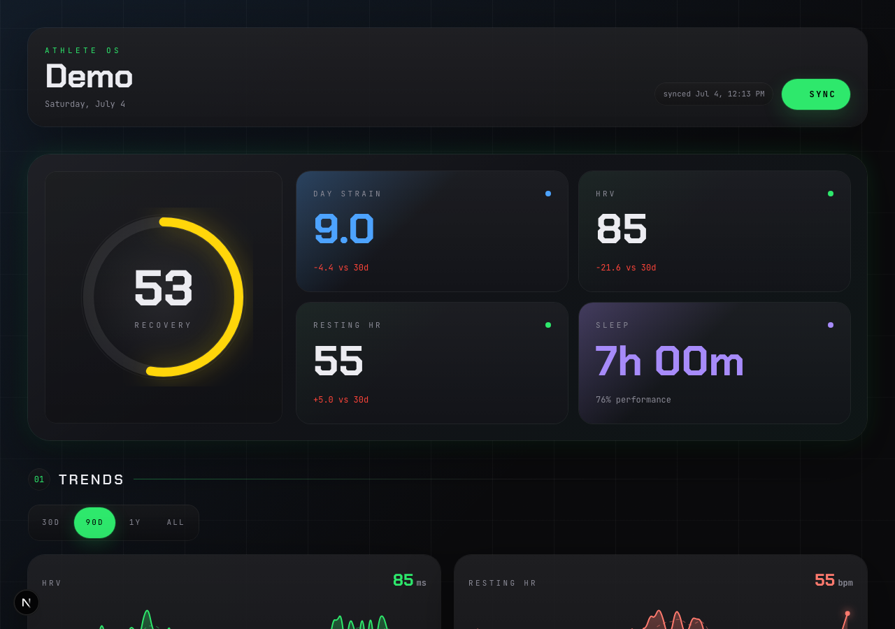

# Athlete OS

Self-hosted WHOOP dashboard for people who want their recovery, sleep, strain,
and workout history on their own computer or VPS.

The app uses React + Vite for the interface and Hono on Node.js for OAuth,
background synchronization, and serving the built frontend. It connects to the
WHOOP API with your own developer credentials and stores your history in SQLite. It is
designed as a single-user self-hosted app: one deployment, one WHOOP account.



## Features

- Recovery hero with strain, HRV, resting heart rate, sleep, and 30-day deltas
- HRV, resting HR, recovery, strain, and sleep trend charts
- Sleep stage breakdown, efficiency, consistency, and weekday patterns
- Workout totals, recent sessions, sport breakdowns, and HR zone bars
- All-time personal records
- 12-month recovery heatmap
- Local SQLite storage with no analytics or hosted backend

## Requirements

- Node.js 24.21.0 LTS (`.nvmrc`, `.node-version`, Docker and CI use this version)
- Docker + Docker Compose for containerized self-hosting
- A WHOOP account
- A WHOOP developer app for your own deployment

## WHOOP app setup

Every person running this app should create their own WHOOP developer app.
Do not commit or share your Client Secret.

1. Open `https://developer.whoop.com/` and sign in.
2. Create an app. Any name is fine, for example `Athlete OS`.
3. Add your redirect URI:
   - Local: `http://localhost:3000/api/auth/callback`
   - VPS/domain: `https://whoop.example.com/api/auth/callback`
4. Enable scopes: `read:profile`, `read:body_measurement`, `read:cycles`,
   `read:recovery`, `read:sleep`, `read:workout`, `offline`.
5. Copy the Client ID and Client Secret into your environment file.

## Local install

```bash
git clone https://github.com/agabekov/athlete_os.git
cd athlete_os
nvm install # or install Node 24.21.0 with your preferred version manager
nvm use
npm ci
cp .env.example .env.local
```

Edit `.env.local`:

```env
WHOOP_CLIENT_ID=your_client_id
WHOOP_CLIENT_SECRET=your_client_secret
WHOOP_REDIRECT_URI=http://localhost:3000/api/auth/callback
WHOOP_ALLOWED_HOSTS=
```

Run it:

```bash
npm run dev
```

Open `http://localhost:3000`, connect WHOOP, then run the first sync.

## Docker / VPS install

For a VPS, put the app behind HTTPS with a reverse proxy such as Caddy, Nginx,
Traefik, or Cloudflare Tunnel. The app has no built-in login system; if the URL
is reachable by other people, add access control at the proxy layer.

```bash
git clone https://github.com/agabekov/athlete_os.git
cd athlete_os
cp .env.example .env
```

Edit `.env`:

```env
WHOOP_CLIENT_ID=your_client_id
WHOOP_CLIENT_SECRET=your_client_secret
WHOOP_REDIRECT_URI=https://whoop.example.com/api/auth/callback
WHOOP_ALLOWED_HOSTS=whoop.example.com
```

Start:

```bash
docker compose up -d --build
```

The container listens on port `3000`; Compose publishes it only on `127.0.0.1`,
so external traffic goes through your reverse proxy and its access controls. Change the host port with:

```env
PORT=8080
```

Then point your reverse proxy at `http://127.0.0.1:8080`.

## Host allow-list

The app rejects requests whose `Host` header is not explicitly allowed.

- `localhost`, `127.0.0.1`, and `::1` are always allowed.
- Public domains must be listed in `WHOOP_ALLOWED_HOSTS`.
- Use comma-separated hostnames for multiple domains:

```env
WHOOP_ALLOWED_HOSTS=whoop.example.com,www.whoop.example.com
```

This protects local users from DNS rebinding and prevents accidental exposure on
unexpected hostnames.

## Data storage

- Local default: `data/whoop.db`
- Docker default: `/app/data/whoop.db`
- Override with `WHOOP_DB_PATH`

The SQLite database contains synced WHOOP history and OAuth tokens. Back it up
carefully, protect file permissions, and delete `whoop.db*` if you want to reset
and reconnect from scratch.

## Troubleshooting

### WHOOP asks me to log in every time

The app should only need the WHOOP login once. After the callback succeeds it
stores a refresh token in SQLite and refreshes access tokens in the background.

If you are prompted every time, the app is probably not seeing the same database
between runs:

- Keep `data/whoop.db`, `data/whoop.db-wal`, and `data/whoop.db-shm` on local
  installs.
- For Docker, keep the `whoop-data:/app/data` volume from `docker-compose.yml`.
- For custom hosting, set `WHOOP_DB_PATH` to a persistent disk path.
- Do not run `node scripts/seed-demo.mjs` against your real account database.
- If you changed WHOOP client credentials, changed the redirect URI, or revoked
  the app in WHOOP, reconnect once.

Visiting `/api/auth/login` while already connected redirects back to the
dashboard instead of starting a new WHOOP authorization flow. A database is bound
to one WHOOP user ID. Reconnecting another account is rejected without deleting
any history; use a separate `WHOOP_DB_PATH` for another account.

## Development

```bash
npm test
npm run typecheck
npm run lint
npm run build
npm audit
npx playwright install chromium
npm run test:e2e
```

Seed fake data for UI work:

```bash
npm run seed:demo
WHOOP_DB_PATH=data/whoop-demo.db npm run dev
```

The seed script writes a separate `data/whoop-demo.db` and refuses to overwrite
an occupied database or the real default path. Set WHOOP developer credentials
in `.env.local` to pass the setup screen; seeded demo tokens are fake, so use
demo data for interface work only. Do not run sync against the demo database.
To regenerate demo data, choose a new empty path with `WHOOP_DB_PATH`.

Build and run production locally:

```bash
npm run build
WHOOP_CLIENT_ID=your_client_id WHOOP_CLIENT_SECRET=your_client_secret npm start
```

Production reads environment variables supplied by the process or Docker; it
does not load local environment files. `HOST` defaults to `127.0.0.1`, and `PORT`
defaults to `3000`. Development loads `.env.local`, then `.env`, while preserving
already supplied environment variables.

## Synchronization and upgrades

The Sync button starts a background job and polls its status. Closing a browser
tab does not cancel the job. Concurrent sync requests share the same operation.
Requests have a 20-second deadline and each WHOOP client has a 15-minute total
budget. Interrupted jobs can be retried without advancing an unfinished resource
checkpoint. The header reports the latest measurement date, the last fully
completed sync, and incomplete sync status.

Run one server process per database. A process restart stops a running job; its
incomplete state is retained, and the next Sync resumes safely. On upgrade from
the previous schema, the first sync reloads all resources once to establish
reliable checkpoints. Existing history and credentials are preserved. Back up
your database before upgrading.

The dashboard uses calendar-day ranges and keeps missing measurements as gaps.
Workout frequency is labeled with its observed calendar interval, including rest
days. Fonts are bundled locally; the browser does not fetch them from Google.

See [AGENTS.md](AGENTS.md) for module boundaries and verification guidance.

## License

MIT. See [LICENSE](./LICENSE).
